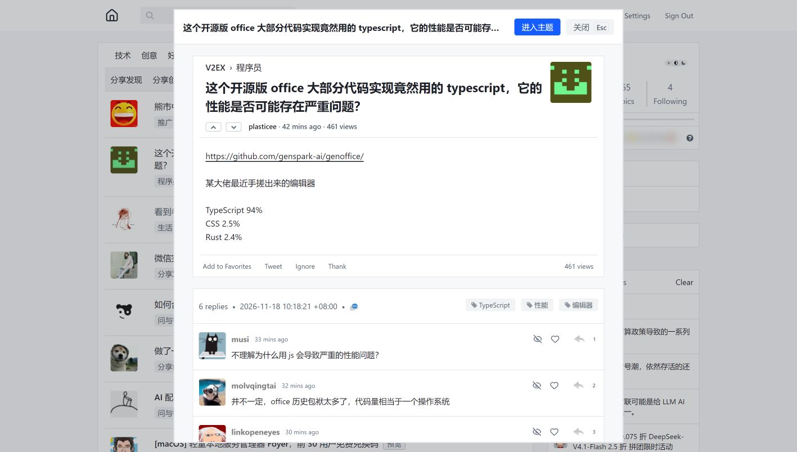
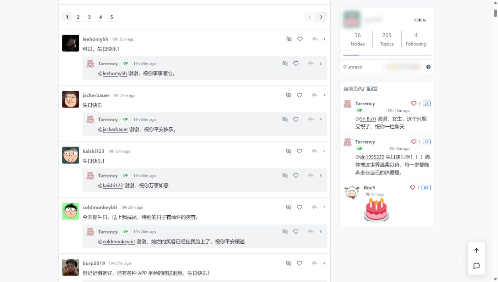
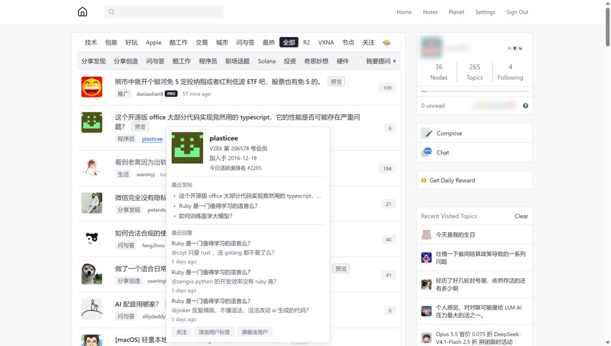
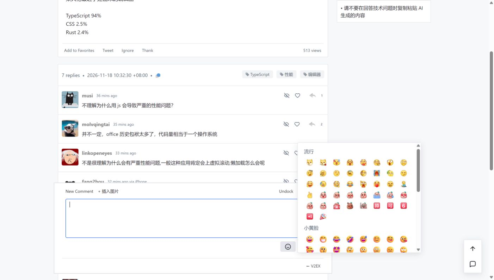
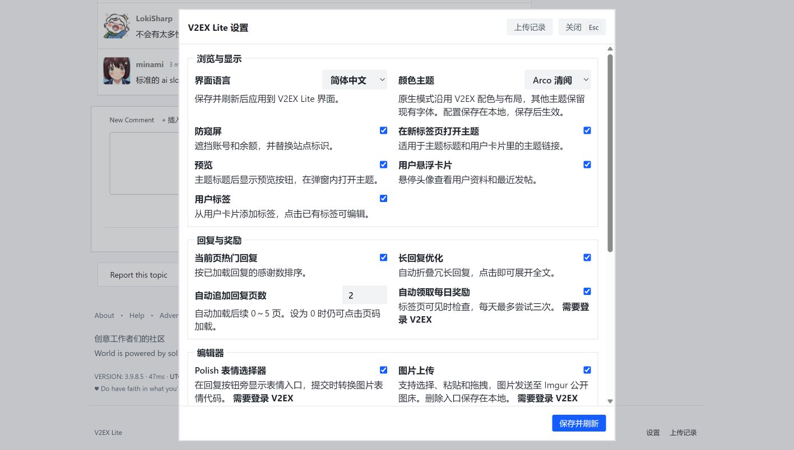

# V2EX Lite

V2EX Lite 是一个改善 V2EX 阅读与回复体验的浏览器用户脚本，提供主题切换、帖子预览、多页回复浏览、用户标签和图片上传等功能。安装后直接在 V2EX 页面使用，无需部署服务器。

[安装脚本](https://raw.githubusercontent.com/ryan961/v2ex-scripts/main/dist/v2ex-lite.user.js) · [正式版本](https://github.com/ryan961/v2ex-scripts/releases/latest) · [问题反馈](https://github.com/ryan961/v2ex-scripts/issues)

## ✨ 主要功能

- **主题外观**：默认 Arco 清阅，也可选择 Minimalist 或 V2EX 原生外观，适配浅色、深色和跟随系统模式。
- **帖子阅读**：弹窗预览帖子、站内查看大图、新标签页打开和长回复折叠。
- **回复浏览**：多页回复预加载、页码定位、热门回复侧栏，兼容原生回复布局。
- **用户管理**：悬浮卡片展示用户信息、最近主题与回复，支持关注、屏蔽、多标签编辑和分组筛选。
- **回复辅助**：浮动回复框、表情选择、Imgur 图片上传，以及带图片预览和来源主题的上传记录。
- **日常工具**：自动签到、防窥屏，以及页面两侧的设置、返回顶部和回复快捷按钮。

## 📷 功能演示

以下图片截自实际浏览器中的 V2EX 页面，使用 Arco 清阅主题，并开启防窥屏。点击图片可查看原图，展开条目可查看更多功能。

**帖子预览**：在列表中直接阅读正文和回复。预览中的跨域链接会在新标签页打开。登录后可在预览窗口回复，启用表情功能后可插入表情。

[](docs/images/topic-preview.jpg)

<details>
<summary>回复浏览：多页回复与热门回复侧栏</summary>

预加载后续回复，通过页码定位阅读位置；右侧按感谢数展示已加载回复中的热门内容。

[](docs/images/reply-reading.jpg)

</details>

<details>
<summary>用户卡片：资料、近期动态与标签入口</summary>

悬停用户名或头像即可查看资料、活跃度、最近主题与回复，也可从卡片关注用户或添加标签。

[](docs/images/member-cards.jpg)

</details>

<details>
<summary>回复辅助：浮动回复框、表情与图片入口</summary>

点击右下角回复按钮，在当前阅读位置打开回复框；表情选择器和图片上传入口就在编辑区旁边。

[](docs/images/reply-tools.jpg)

</details>

<details>
<summary>设置面板：按需选择主题、语言与功能</summary>

功能按浏览、回复和编辑器分组，需要登录的选项附有说明。

[](docs/images/settings.jpg)

</details>

## 🚀 安装与使用

1. 安装 [Tampermonkey](https://www.tampermonkey.net/)，允许浏览器运行用户脚本。
2. 点击 [安装 V2EX Lite](https://raw.githubusercontent.com/ryan961/v2ex-scripts/main/dist/v2ex-lite.user.js)，在脚本管理器中确认安装。
3. 如果已安装 V2EX Polish、V2EX.REP 等同类增强工具，先停用，再刷新 V2EX，避免重复处理页面。

- **主题**：新安装默认使用 Arco 清阅，可切换至 Minimalist 或 V2EX 原生；升级保留已保存的主题选择，浅色与深色跟随网站设置。
- **语言**：默认使用简体中文，也可选择英语、日语、韩语，或跟随 V2EX。
- **登录状态**：签到、关注、屏蔽和回复辅助等账号功能需要登录；未登录时不启用相应功能。
- **Imgur 图片代理**：在「浏览」设置中开启，默认关闭。帖子、回复和预览中的公开 Imgur 图片通过所选代理加载，大图窗口可打开原图。默认使用 DuckDuckGo，也可自定义 HTTPS 代理。开关和地址可随 JSON 或 V2EX 记事本备份迁移。

### 页面快捷工具

| 位置   | 按钮                 | 显示与操作                                                                                           |
| ------ | -------------------- | ---------------------------------------------------------------------------------------------------- |
| 左下角 | 设置（齿轮）         | 默认隐藏，鼠标移至左下角时显示。点击打开设置，可管理功能、用户标签、备份与恢复，也可进入上传记录。   |
| 右下角 | 返回顶部（向上箭头） | 向下滚动后显示。点击同时将页面和右侧栏滚动到顶部。                                                   |
| 右下角 | 回复（对话气泡）     | 登录后，在有可编辑回复框的帖子页显示。点击浮动显示回复框并聚焦输入，保留当前阅读位置和已输入的草稿。 |

设置也可从网页底部或 Tampermonkey 菜单进入；右下角按钮的实际效果见上方「回复浏览」和「回复辅助」演示图。

## ⚡ 可选：减少刷新时的样式闪动

如果刷新或切换节点时先看到原站样式，再变成脚本主题，可以调整 Tampermonkey 的 **Content Script API**。它决定用户脚本的注入方式和时机。V2EX Lite 已请求在 `document-start` 执行，并在识别到页头后应用主题；若注入较晚，仍可能错过页面的首次绘制。

Chrome 的 Manifest V3 版 Tampermonkey 中，三种模式的区别如下：

| 选项                    | 注入方式                                                | 对提前应用主题的影响                                   |
| ----------------------- | ------------------------------------------------------- | ------------------------------------------------------ |
| Content Script          | 先运行包装代码，再从后台获取用户脚本                    | 不支持即时的 `document-start` 注入，可能先显示原站样式 |
| UserScripts API         | 通过 UserScripts API 注入包装代码，用户脚本仍从后台获取 | 同样不支持即时的 `document-start` 注入                 |
| UserScripts API Dynamic | 将包装代码和用户脚本一起注入                            | 支持即时的 `document-start` 注入，更适合提前应用主题   |

以上区别见 [Tampermonkey 官方说明](https://www.tampermonkey.net/documentation.php?locale=en&q=content_script_api)。**Firefox 的普通 UserScripts API 已支持即时注入**，无需照搬 Chrome 的调整方式。

Chrome 用户可按以下步骤设置：

1. 打开 Tampermonkey 管理面板，在 **设置 → 通用 → 配置模式** 中选择 **高级**，显示高级配置项。
2. 在 **实验 → Content Script API** 中选择 **UserScripts API Dynamic**，保存后刷新 V2EX。

这是可选设置，主要改善主题出现的时机，未调整时也可使用脚本。实际效果仍受浏览器和扩展调度影响，不能保证所有环境完全无闪动。该配置会影响 Tampermonkey 中其他脚本的注入方式；若切换后遇到兼容问题，可恢复原值。具体模式限制见上面的官方说明。V2EX Lite 无需额外安装遮罩脚本或填写网站的 Custom CSS。

## 💾 数据与备份

设置、用户标签和上传记录保存在脚本管理器本地。设置与标签支持本地 JSON 导入导出，也可手动备份到 V2EX 记事本；备份范围、容量限制及恢复规则见 [备份与恢复](docs/backup.md)。

图片上传至 Imgur 公共图床。上传历史保留图片链接、删除入口和来源主题，不包含图片文件本身。

## 本地开发

使用 Node.js 24.15.0+（24 系列）和 npm，其他受支持版本见 [package.json](package.json)。

```sh
npm ci --ignore-scripts
npm run check
```

`check` 执行格式检查、构建和测试。单独构建使用 `npm run build`，安装文件生成于 `dist/v2ex-lite.user.js`。

发版时更新版本号，运行 `npm run check`，将构建产物随版本提交并打标签。发布 GitHub Release 后，Greasy Fork 会从该标签同步 `dist/v2ex-lite.greasyfork.user.js`。此文件保留可读代码和简体中文描述。

## 参考与致谢

- [V2EX Polish](https://github.com/coolpace/V2EX_Polish)：主题、预览、用户卡片、标签、表情和长回复折叠。
- [V2EX.REP](https://github.com/v2hot/v2ex.rep)：热门回复侧栏和图片上传入口。
- [Arco Design](https://arco.design/)：Arco 清阅配色、标签编辑和设置表单的样式参考。

感谢以上项目及其贡献者。移植代码的版权和许可信息见 [第三方声明](THIRD-PARTY-NOTICES.md)。

## 许可证

本项目采用 [MIT 许可证](LICENSE)。
